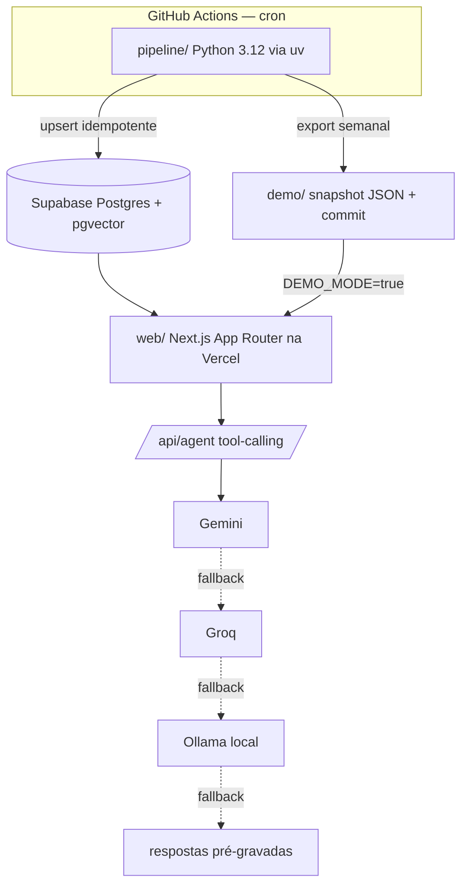

# Nicho Capital — Plano de implementação (proposta, aguardando aprovação)

> Status: **rascunho para aprovação**. Nenhum código foi escrito.
> Verificação de free tiers feita em 31/10/2026 na documentação oficial (e, quando possível, chamando a API de verdade).

---

## 1. Verificação dos serviços (seção 2 do prompt)

Legenda: ✅ confirmado na doc oficial ou por chamada real · ⚠️ confirmado com ressalva · ❓ não deu para confirmar o número na doc pública

| Serviço | O que foi confirmado | Status | Consequência no projeto |
|---|---|---|---|
| **yfinance** | v1.7.0 (26/08/2026) no PyPI. É biblioteca **não oficial**; o próprio PyPI diz que a API do Yahoo é "intended for personal use only". | ⚠️ | Ok para portfólio pessoal. Pode quebrar sem aviso → fica atrás de `QuoteProvider` com fallback. Limites de intraday (janela de 1m/5m) **a confirmar na Fase 2** com teste real. |
| **brapi.dev** | Plano Gratuito R$ 0, sem cartão: **15.000 req/mês**, **só intervalo 1d**, **até 3 meses de histórico**, 1 ativo por requisição, 1 requisição simultânea, cotação atualizada a cada 30 min. Sandbox sem token: PETR4, VALE3, MGLU3, ITUB4 (20 req/min por IP). | ✅ | Serve só como **fallback de cotação recente**, não para os 3 anos de histórico. ~40 tickers × 1 req/dia ≈ 1.200 req/mês: cabe. |
| **SGS / Banco Central** | Endpoint `https://api.bcb.gov.br/dados/serie/bcdata.sgs.{codigo}/dados?formato=json&dataInicial=dd/mm/aaaa&dataFinal=dd/mm/aaaa` e `/dados/ultimos/{N}`. **Séries diárias exigem `dataInicial` e janela máxima de 10 anos** (testado: erro explícito da API). Códigos testados hoje: **11** Selic diária (% a.d.), **432** meta Selic (% a.a., 13,75), **1178** Selic anualizada base 252, **4389** CDI anualizado, **433** IPCA variação mensal (%), **1** dólar PTAX venda, **10813** dólar PTAX compra. | ✅ | Ingestão em janelas ≤ 10 anos. Sem chave. |
| **CVM — IPE** | `https://dados.cvm.gov.br/dados/CIA_ABERTA/DOC/IPE/DADOS/ipe_cia_aberta_AAAA.zip`, atualização **semanal**. Campos (dicionário oficial): `Assunto, Categoria, CNPJ_Companhia, Codigo_CVM, Data_Entrega, Data_Referencia, Especie, Link_Download, Nome_Companhia, Protocolo_Entrega, Tipo, Tipo_Apresentacao, Versao`. | ✅ | **Atualização semanal**: fato relevante de hoje pode não estar no ZIP. Isso precisa aparecer na metodologia. Alternativa para frescor (consulta ao sistema ENET/RAD) só se for pública e permitida; a verificar na Fase 4. |
| **CVM — FCA** | `.../DOC/FCA/DADOS/fca_cia_aberta_AAAA.zip`, semanal. Sub-arquivos: `geral`, `valor_mobiliario` (dá o mapeamento CNPJ ↔ código de negociação), `dri`, `auditor`, `escriturador` etc. | ✅ | Base do cadastro empresa ↔ ticker. |
| **CVM — FRE** | `.../DOC/FRE/DADOS/fre_cia_aberta_AAAA.zip` existe (2024–2026). O dicionário (`META/fre_cia_aberta.zip`) não baixou no teste. | ⚠️ | Nomes dos sub-arquivos de administradores e posição acionária **a confirmar na Fase 5**, antes de usar. |
| **Google News RSS** | `https://news.google.com/rss/search?q=...&hl=pt-BR&gl=BR&ceid=BR:pt-419` responde 200 com XML. **Não existe documentação oficial pública nem SLA** para esse feed. | ❓ | Usar com moderação, cache e User-Agent identificado. Tratar como fonte que pode sumir. Os RSS dos portais (lista em `config/sources.yaml`) vêm primeiro. |
| **GDELT DOC 2.0** | `https://api.gdeltproject.org/api/v2/doc/doc`, params `query`, `mode=artlist`, `format=json`, `maxrecords` (≤ 250), `timespan`, `startdatetime/enddatetime`. Janela **rolante de 3 meses**. `sourcecountry:`/`sourcelang:` vão **dentro** de `query`. A própria API respondeu: **"limit requests to one every 5 seconds"**. | ✅ | Rate limiter de 1 req / 5 s. |
| **Gemini API** | Free tier ("Free of charge") existe para `gemini-2.5-flash`, `gemini-2.5-flash-lite`, `gemini-3.x-flash(-lite)` e `gemini-embedding-001/2`. No free tier, **"Used to improve our products: Yes"**. Os **números de RPM/RPD não estão mais na doc pública**: ela manda ver no AI Studio. Limites são por projeto e resetam à meia-noite do Pacífico. | ❓ números | Só mandamos dados públicos, então o uso para treino é aceitável (vai no README). **Cotas configuráveis** em `config/llm.yaml`; você confere os números no AI Studio quando criar a chave. |
| **Groq** | Todos os modelos hospedados suportam tool use (inclui `llama-3.3-70b-versatile`, `llama-3.1-8b-instant`, `openai/gpt-oss-120b/20b`). Free plan existe, mas a tabela pública mostra só limites do plano Developer. Os números exatos do free ficam no console. | ❓ números | Mesmo tratamento: cota em config, conferida no console. |
| **FinBERT-PT-BR** | `lucas-leme/FinBERT-PT-BR` existe no Hugging Face, Apache-2.0, labels POSITIVE/NEGATIVE/NEUTRAL (segundo o exemplo do card). O modelo antigo `turing-usp/FinBertPTBR` está marcado como depreciado. | ✅ | Roda **local em CPU** com `transformers` (sem API). Ler `config.json` na Fase 4 para confirmar a ordem dos labels. |
| **Supabase Free** | 500 MB de banco, **2 projetos ativos**, **pausa após 7 dias de inatividade**, 5 GB de egress, 1 GB de storage. A página de preços não diz se pede cartão. | ⚠️ | 500 MB comporta o projeto (40 tickers × 3 anos ≈ 30 mil linhas de preço; embeddings 384-d de alguns milhares de notícias ≈ poucos MB). O cron diário evita a pausa. Cartão: confirmar no cadastro. |
| **GitHub Actions** | Runners padrão **gratuitos em repositório público**. Doc oficial: em repo público, **workflows agendados são desativados após 60 dias sem atividade no repositório**. | ✅ | Segundo risco de "pausa", além do Supabase. Mitigação: o pipeline faz commit semanal do snapshot `demo/` (ver Riscos). |
| **Vercel Hobby** | Grátis, **uso pessoal e não comercial**. 1M invocações, 4 CPU-h ativas, 100 GB de transferência/mês, duração máxima de função **300 s**, 100 deploys/dia, logs de 1 h. Se estourar, o recurso para por até 30 dias (não cobra). | ✅ | Portfólio pessoal se encaixa. Rate limit na `/api/agent` protege CPU e cota de LLM. |

**Precisam de conta (sem cartão):** Google AI Studio (Gemini), Groq, Supabase, Vercel e GitHub. Telegram é opcional e fica para depois.

---

## 2. Ambiente desta máquina (verificado)

| Ferramenta | Situação | Ação |
|---|---|---|
| Node.js | v26.13.0 + npm 11.20 | ok |
| git | 2.45.1 | ok |
| uv | 0.11.6 | ok, e **resolve o Python**: `uv python install 3.12` instala sem Microsoft Store |
| Docker | 29.9.2 | ok (opcional: Postgres + pgvector local) |
| Python | só o atalho da Store | **não instalar pela Store**; o uv cuida disso |
| Ollama | **não instalado** | instalar (necessário para o modo 100% local com LLM) |
| make | **não instalado** | instalar *ou* usar os scripts equivalentes (ver abaixo) |
| gh CLI | não instalado | opcional (ajuda no setup de secrets) |

**O que você precisa instalar:**
1. **Ollama** (ollama.com/download, instalador Windows) e depois `ollama pull` de um modelo pequeno com tool calling. Vou sugerir o modelo exato na Fase 6, conforme o que couber na sua RAM.
2. **make**: `winget install ezwinports.make` (ou equivalente). Alternativa sem instalar nada: o repositório terá `scripts/*.ps1` e `npm run demo` fazendo o mesmo que o Makefile.
3. (Opcional) **gh**: `winget install GitHub.cli`.

---

## 3. Arquitetura proposta

### Decisões técnicas principais

| # | Decisão | Por quê | Alternativa |
|---|---|---|---|
| D1 | **Postgres é o único schema canônico** (migrations SQL em `db/migrations/`, aplicadas pelo pipeline). Local: Supabase remoto **ou** Postgres + pgvector via Docker. | O web e o pipeline falam com um banco só. Manter SQLite/DuckDB em paralelo dobraria o trabalho e o risco de divergência. | Backend DuckDB local no pipeline, só se você quiser rodar sem Docker e sem Supabase. |
| D2 | **Modo demo lê um snapshot JSON** (`demo/*.json`, com embeddings pré-calculados), por um adapter `DataSource` no web. Não precisa de banco nem de Python. | `make demo` vira "instalar Node e rodar": o caminho mais robusto para a entrevista. A busca semântica no demo é cosseno em TS sobre poucos milhares de vetores. | Demo com Postgres em Docker (mais fiel, mas mais pesado e frágil no notebook da entrevista). |
| D3 | Python **3.12** com `uv` (workspace em `pipeline/`), `pydantic v2`, `httpx` + `tenacity`, `structlog`, `ruff`, `mypy`, `pytest` + JSON gravados. | O prompt pede 3.11+. A 3.12 tem wheels para torch, arch e ruptures no Windows e no Linux. | 3.11 |
| D4 | Web: Next.js (App Router) + TS + **Tailwind v4** (`@theme` num único `tokens.css`) + shadcn/ui re-tokenizado + TanStack Query. | A identidade já entrega um bloco `@theme` v4. Um arquivo de tokens só, como o prompt pede. | Tailwind v3 com `tailwind.config.ts` |
| D5 | Camada **`providers/`** com interface e fallback para cotações, LLM e notícias, nos dois lados (Python e TS), com circuit breaker simples e contador de cota persistido na tabela `quota_usage`. | É requisito do prompt e alimenta a página `/status`. | — |
| D6 | LLM do agente com **contrato OpenAI-compatível** onde der (Groq e Ollama expõem esse formato; Gemini tem SDK próprio). Um adapter por provedor e um formato interno de tool-call. | Fallback limpo entre os três. | Vercel AI SDK, que tem providers para os três. Avalio na Fase 6; reduz código, mas é mais uma dependência. |
| D7 | Embeddings `intfloat/multilingual-e5-small` (384-d) no pipeline. A query do agente chega ao vivo no web e precisa do **mesmo** espaço vetorial (um embedding do Gemini não serviria). **Decisão:** embedar a query no Next.js com `transformers.js` e o mesmo e5-small em ONNX (repositório ONNX a verificar na Fase 4). | Mesmo espaço vetorial no pipeline e no web, sem custo e funcionando offline. | Busca só por texto (Postgres FTS em português) como fallback, se o modelo ONNX pesar demais na função da Vercel. |
| D8 | Cron diário em **dias úteis às 09:00 BRT = 12:00 UTC** (`0 12 * * 1-5`), mais uma rodada pós-fechamento às **21:30 UTC** para os preços do dia. | O briefing fica pronto antes das 10h. O Brasil não tem horário de verão desde 2019, então UTC−3 fixo. | — |

---

## 4. Fase 1 — Fundação (plano detalhado)

**Entrega funcional:** o repositório roda `npm run dev` com o layout base no visual Altitude e todas as 8 rotas como "casca" (skeleton e estado vazio), `uv run pytest` passa, e a CI fica verde no GitHub.

### 4.1 Repositório e tooling
- `git init`, `.gitignore` (Python, Node, `.env`, caches de modelos), `LICENSE` MIT, `README.md` inicial (pitch + diagrama mermaid + "como rodar").
- `.editorconfig`, `.gitattributes` (LF), configurações de `core.longpaths` documentadas para o Windows.
- **Makefile** com `setup`, `dev`, `pipeline`, `test`, `lint`, `demo`, mais `scripts/*.ps1` espelhando os mesmos alvos para Windows sem make.
- `.env.example` documentado: `DATABASE_URL`, `GEMINI_API_KEY`, `GROQ_API_KEY`, `OLLAMA_BASE_URL`, `DEMO_MODE`, `COLLECTOR_USER_AGENT`, `BRAPI_TOKEN` (opcional).

### 4.2 Config central (`config/`)
- `universe.yaml`: ~40 tickers líquidos do Ibovespa + `^BVSP`, com setor, nome, CNPJ e apelidos para busca. Lista inicial proposta por mim e revisada por você.
- `sources.yaml`: feeds RSS. Só entram feeds que eu abrir e confirmar que existem; nada inventado.
- `scoring.yaml`: pesos do score de relevância (valores iniciais documentados).
- `llm.yaml`: provedores, modelos e cotas (RPM/RPD) **editáveis**, porque a doc não publica os números.
- Schemas Pydantic para validar os YAMLs, com teste.

### 4.3 Banco (`db/migrations/`)
- `0001_init.sql`: `extension vector`; tabelas `assets`, `prices_daily`, `prices_intraday`, `macro_series`, `macro_observations`, `filings`, `news_items`, `stories`, `story_items`, `extractions`, `sentiment`, `anomalies`, `event_studies`, `graph_snapshots`, `kg_nodes`, `kg_edges`, `relevance_scores`, `briefings`, `pipeline_runs`, `quota_usage`, `llm_cache`.
- Chaves naturais + `content_hash` com `unique` → upserts idempotentes desde o primeiro dia.
- Runner de migrations mínimo em Python (tabela `schema_migrations`), sem ORM pesado.

### 4.4 Pipeline (esqueleto)
- `pipeline/` com `pyproject.toml` (uv), pacotes `ingest/ extract/ stats/ graphs/ scoring/ briefing/ prompts/ providers/ tests/`.
- `nicho` CLI (`typer`): `nicho migrate`, `nicho run --stage ...`, `nicho export-demo`.
- `pipeline_runs`: context manager que grava status, duração, contagens e erro.
- Logs estruturados em JSON.
- Testes: config válida, idempotência do runner de migrations (contra Postgres do Docker na CI via `services:`).

### 4.5 Design tokens e layout base (`web/`)
- `web/src/styles/tokens.css`: **único** arquivo com todas as variáveis Altitude + as extensões aprovadas da seção 6 (tokens de dados).
- Fontes via `next/font/google` (Libre Baskerville 400, Inter, Fira Code). Funciona offline depois do build.
- Componentes base re-tokenizados: `Button` (ghost), `Badge`, `Card`, `Input`, `DataTable`, `Delta` (variação com sinal + seta + texto acessível), `Skeleton`, `EmptyState`, `ErrorState`, `StaleDataStamp` ("dados com atraso, não é tempo real · atualizado às HH:MM"), `Disclaimer` fixo.
- App shell: barra superior de 64 px com wordmark "Nicho Capital" em serif, navegação das 8 rotas, `/` com placeholders.
- ESLint com regra que **proíbe hex/rgb literais** fora de `tokens.css` (cumpre "nada hardcoded"), Prettier, `vitest` + Testing Library, `@axe-core/playwright` num smoke test.
- Linha de cume (ridge) em SVG 1px na home: é o único gráfico decorativo da identidade. **Ideia:** desenhar o cume a partir da série real do Ibovespa.

### 4.6 CI (`.github/workflows/ci.yml`)
- Jobs `python` (ruff, mypy, pytest) e `web` (lint, typecheck, vitest, build), com cache do uv e do npm.
- `pipeline.yml` criado já na Fase 1, mas **desligado** (só `workflow_dispatch`) até a Fase 7.

### 4.7 Docs
- `docs/decisoes-de-design.md`: conflitos e resoluções aprovados (seção 6 abaixo).
- `docs/ADRs/0001` a `0004`: banco canônico, modo demo por snapshot, cadeia de fallback de LLM, tokens.

**Critério de pronto da Fase 1:** `make test` verde, `npm run build` ok, app aberto no navegador com o visual aplicado, axe sem violações nas cascas, CI verde no primeiro push.

---

## 5. Visão geral das Fases 2 a 8

| Fase | Entrega | Destaques técnicos | Riscos específicos |
|---|---|---|---|
| **2. Dados de mercado** | Home com Ibovespa, altas/baixas, heatmap setorial, macro; `/ativo/[ticker]` com Lightweight Charts | yfinance (3 anos diário) → fallback brapi (só recente); SGS em janelas ≤ 10 anos; ISR de 15 min | yfinance instável; brapi free não cobre histórico |
| **3. Estatística** | Painel de anomalias, GARCH, event study com CAR + IC | `arch` GARCH(1,1); z-score robusto (mediana/MAD); `ruptures`; modelo de mercado OLS (`statsmodels`); teste com **efeito sintético conhecido**; cobertura ≥ 70% | Event study com janela de estimação contaminada por outro evento → regra de exclusão documentada |
| **4. Notícias e CVM** | `/noticias` com histórias deduplicadas e score decomposto | RSS + Google News + GDELT (1 req/5 s); dedupe e5 + cosseno → histórias; extração JSON Pydantic com reparo único e cache por hash; FinBERT local; kappa de Cohen LLM × FinBERT; BH na correção | Cota do LLM (por isso prioridade por materialidade e cache); IPE semanal; torch CPU pesado na CI |
| **5. Grafos** | `/grafos`: MST com slider temporal, grafo de conhecimento, choque | Distância de Mantegna, MST, Louvain (networkx nativo), centralidades, PPR para choque; layout pré-calculado em Python; Sigma.js + graphology | Performance do grafo de conhecimento → poda por peso e decaimento |
| **6. Agente** | `/analista` com streaming, passos visíveis e tools colapsáveis | Tool-calling Gemini → Groq → Ollama; `explain_move`; rate limit por IP; sem recomendação de compra e venda | Divergências de tool-calling entre provedores; função Vercel ≤ 300 s |
| **7. Briefing + automação** | `/briefing` (com CSS de impressão) e `/status` | Cron 12:00 UTC; briefing só com dados do banco + citação por afirmação; versionado | Pausa do Supabase (7 dias) e do cron (60 dias) |
| **8. Polimento** | `make demo` offline, `/metodologia` com KaTeX, README com GIF, `roteiro-demo.md`, Lighthouse ≥ 90, deploy | Snapshot `demo/` real; respostas pré-gravadas do agente; auditoria a11y | Lighthouse com Sigma/Charts → carregamento lazy |

---

## 6. Conflitos entre o prompt e a identidade "Altitude"

| # | Conflito | Proposta de resolução |
|---|---|---|
| C1 | **Alta e baixa**: o prompt pede "verde e vermelho acessíveis"; a identidade proíbe cores semânticas novas. | **Significado sempre por sinal + seta + texto** (`▲ +2,31%`, com `aria-label` "alta de 2,31%"); isso já cumpre o "nunca só a cor". A cor é um **reforço restrito a marcas de dados** (candles, barras, células do heatmap, deltas numéricos), via tokens `--data-up` e `--data-down` **dessaturados** (ex.: `#7fb89a` 7,8:1 e `#d98c8c` 6,8:1 sobre o canvas). **Nunca** em botões, badges, fundos de card ou chrome. Inclui um toggle "modo monocromático" (só sinal e peso) para quem quiser a identidade 100% pura. |
| C2 | **Tema claro**: o prompt pede claro e escuro "se a identidade permitir"; a Altitude é **só dark**. | **Somente dark** na interface. A exceção é o **CSS de impressão** do `/briefing` (fundo branco, texto escuro, serif), que é o único "tema claro" e faz sentido para PDF e papel. |
| C3 | **Azul de destaque falha AA em superfícies elevadas**: `#2b7fff` tem 4,72:1 no canvas, mas **4,38:1** no card `#1f1f1f` e 4,02:1 em `#262626`. | Criar o token `--color-voltage-blue-text` mais claro (ex.: `#4d94ff`, a validar ≥ 4,5:1 em todas as superfícies) para links em cards. O `#2b7fff` original fica para o anel de foco e as seleções (exigem só 3:1). |
| C4 | **Smoke `#5e5d59` usado como texto** (placeholders, baixa ênfase) tem só 2,3–2,9:1, e reprova no AA. | Smoke só para bordas e divisores. Placeholders e texto de baixa ênfase usam **Fog `#a4a19b`** (≥ 4,98:1 em todas as superfícies). |
| C5 | **Mid Navy `#1a365d` para ícones** tem 1,5:1 no escuro, praticamente invisível. Na identidade ele só funciona sobre os tiles claros. | Ícones em Fog no escuro. O Navy fica restrito a bordas decorativas de heading. |
| C6 | **Fontes de 8–10 px** em contextos densos vs. legibilidade e Lighthouse. | Mínimo de **11 px** para qualquer texto com informação (headers de tabela 11 px uppercase, como a própria identidade especifica). 10 px só em ticks de eixo de gráfico, com `aria` equivalente. |
| C7 | **Cores categóricas nos grafos** (comunidades Louvain) vs. "um só azul". | Comunidades por **escala de cinzas + rótulo + forma do nó** e realce em azul do selecionado. Opcional, se ficar ilegível: paleta `--viz-cat-1..6` de baixa saturação, **só dentro do canvas do grafo**, documentada como exceção. Proponho testar o monocromático primeiro. |
| C8 | **Fotografia de montanha** é a imagem principal da identidade; não temos fotos com licença garantida. | Sem fotos. Usar só a **linha de cume em SVG**, desenhada com a série real do Ibovespa. Fica on-brand e conta a história do produto. |
| C9 | **Navegação de 3 links, sem sticky e sem hamburger** vs. 8 páginas e o requisito de funcionar no celular. | Desktop: barra de 64 px com os 8 itens em Inter 13 px (cabe em 1200 px). Mobile: a barra vira uma **faixa rolável horizontal**, sem hamburger, coerente com a regra. Sem sticky, como diz a identidade. |
| C10 | **Display serif de 72 px** num app denso de dados. | Serif só em títulos de página (28–36 px) e no hero da home e do briefing. Todo o resto é Inter. |
| C11 | **Detalhes da própria identidade**: `--shadow-subtle-4` contém um coral `rgb(232,110,88)` escondido; o fallback da Libre Baskerville lista fontes **sans-serif**; Ash `#e4e4e4` descrito como "borda secundária" seria clarão no escuro; os pontos de semáforo do "Terminal Window" são vermelho/amarelo/verde. | Não usar `shadow-subtle-4`. Corrigir o fallback para `Georgia, 'Times New Roman', serif`. Bordas em `#262626`/Pewter (como a própria "Quick Color Reference" indica). Sem semáforo: não estamos fazendo screenshot de marketing. |
| C12 | **Status por cor** (pipeline ok/falhou em `/status`; sentimento positivo/negativo nos cards). | Seguir a identidade: status por **texto + peso + borda** (badge "FALHOU" com borda 2px Bone; "OK" com borda 1px Smoke). Sentimento como texto e glifo (`+`, `·`, `−`), não como cor. |

Depois da sua aprovação, essas resoluções viram `docs/decisoes-de-design.md` e os tokens correspondentes.

---

## 7. Riscos e mitigações

| Risco | Prob. | Mitigação |
|---|---|---|
| **Cron do GitHub desativado após 60 dias sem atividade** (repo público) | alta, a longo prazo | O pipeline faz **commit semanal** do snapshot `demo/`, o que conta como atividade e ainda mantém a demo fresca. Também documentado no README. |
| **Supabase pausa após 7 dias** | baixa (cron diário escreve) | Escrita diária em `pipeline_runs`. Se pausar, o web cai para o snapshot automaticamente (banner "modo snapshot"). |
| yfinance quebra ou é bloqueado | média | Fallback brapi (recente), snapshot e testes que não dependem de rede. |
| Cotas do Gemini e do Groq menores que o esperado (números não publicados) | média | Cache por hash, extração só de itens novos, priorização por materialidade, Flash-Lite para volume e fallback em cadeia. |
| torch + FinBERT + e5 deixam a CI lenta ou estouram memória | média | Wheel CPU do torch, cache do HF no Actions e inferência em lote. FinBERT roda só em itens novos. |
| IPE semanal (fato relevante atrasado) | certa | Transparência na metodologia. As notícias cobrem o "hoje". |
| Ollama não instalado / modelo local fraco em tool-calling | média | Respostas pré-gravadas no modo demo como última camada. |
| Escopo grande para um portfólio | alta | Cada fase entrega algo demonstrável. O node2vec fica marcado como opcional. |

---

## 8. Próximo passo

Aprovar (ou ajustar):
1. As decisões **D1, D2 e D7** (banco canônico Postgres, demo por snapshot JSON, embedding da query no web via transformers.js).
2. As resoluções **C1 a C12**, principalmente a C1 (cor só como reforço em marcas de dados).
3. O nome "Nicho Capital" e a lista inicial de tickers (eu proponho na Fase 1).

Com o OK, começo a Fase 1.
